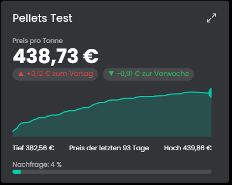

# HolzpelletsPreis
Die Bibliothek ruft den aktuellen Preis für Holzpellets von Heizpellets24 (Deutschland und Österreich) ab.

## Inhaltsverzeichnis
- [HolzpelletsPreis](#holzpelletspreis)
  - [Inhaltsverzeichnis](#inhaltsverzeichnis)
  - [Screenshots](#screenshots)
  - [1. Voraussetzungen](#1-voraussetzungen)
  - [2. Funktionsumfang](#2-funktionsumfang)
  - [3. Enthaltene Module](#3-enthaltene-module)
  - [4. Installation](#4-installation)
  - [5. Konfiguration in IP-Symcon](#5-konfiguration-in-ip-symcon)
  - [6. Spenden](#6-spenden)
  - [7. Lizenz](#7-lizenz)

## Screenshots

## 1. Voraussetzungen

* mindestens IPS Version 9.0
* Internetzugang für den Abruf von heizpellets24.de bzw. heizpellets24.at

## 2. Funktionsumfang
* Abruf des aktuellen Pelletpreises pro Tonne und der Nachfrage
* Wahl zwischen Deutschland und Österreich
* Automatische Aktualisierung im einstellbaren Intervall
* Kachel für die Kachel-Visualisierung mit Preisverlauf, wahlweise aus dem eigenen Archiv

Die einzelnen Funktionen stehen bei den Instanzen unter "Enthaltene Module" und in der README des jeweiligen Moduls.

## 3. Enthaltene Module

* [HolzpelletsPreis](HolzpelletsPreis/README.md)
  * Ruft den aktuellen Preis pro Tonne und die Nachfrage von Heizpellets24 ab.
  * Bringt eine Kachel mit Preisverlauf und Trend mit.

## 4. Installation
Die Installation erfolgt über den IP-Symcon Module Store.

## 5. Konfiguration in IP-Symcon
Eine Instanz "HolzpelletsPreis" anlegen, Land und Aktualisierungsintervall wählen und die Instanz aktivieren. Die Einzelheiten stehen in der README des Moduls.

## 6. Spenden
Dieses Modul ist für die nicht kommerzielle Nutzung kostenlos, Schenkungen als Unterstützung für den Autor werden hier akzeptiert:

 

## 7. Lizenz

[CC BY-NC-SA 4.0](https://creativecommons.org/licenses/by-nc-sa/4.0/)
